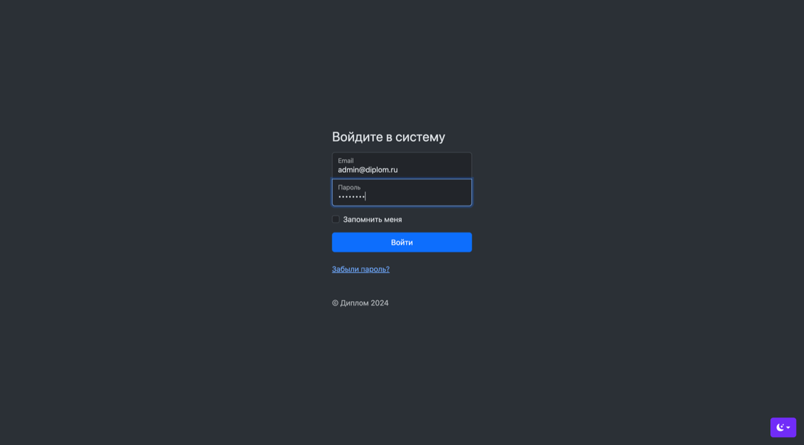
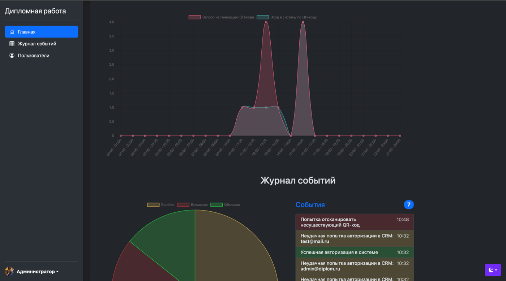
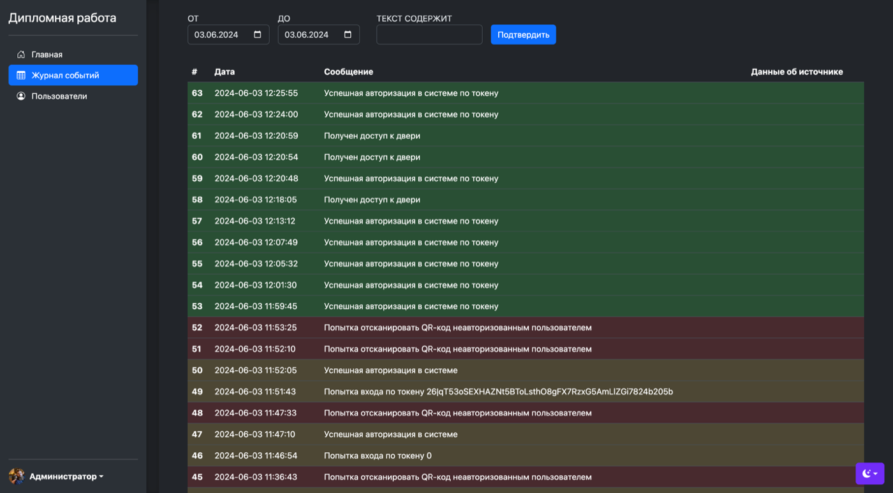
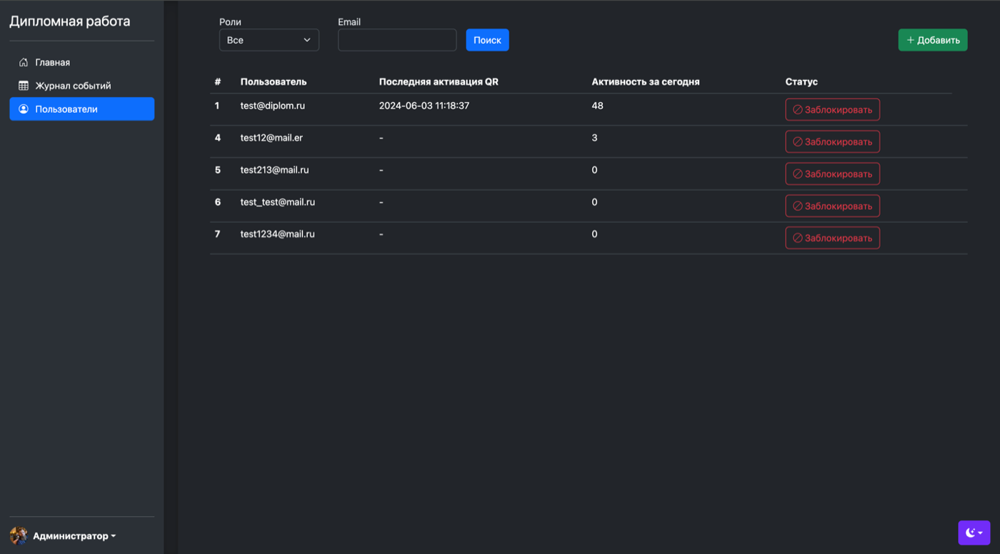
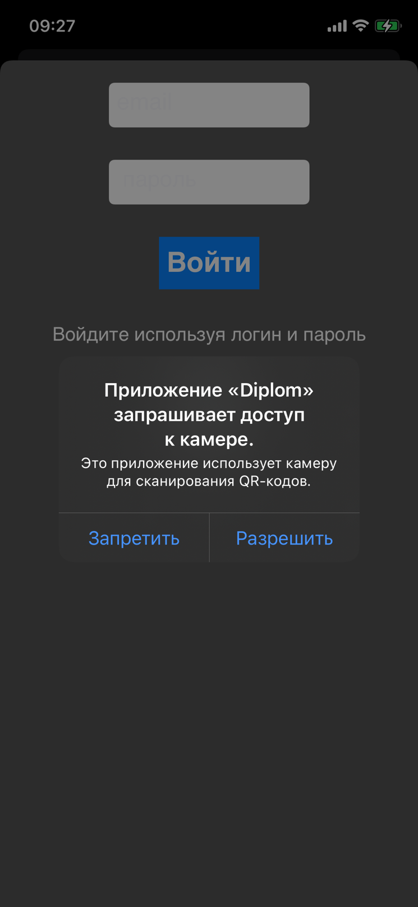

# Access Control System

[](https://github.com/Ruslan131132/access-control-system/actions/workflows/ci.yml)

Physical access control system built with **Laravel 11**: a mobile client generates a one-time QR code, the reader verifies identity through the API, the door relay is unlocked via GPIO (or a mock driver), and every event flows through **RabbitMQ**.

The CRM panel shows the event journal, QR generation/activation stats, and user management.

---

## Screenshots

### CRM

<p align="center">
  
  <br/>
  <em>Admin login to the CRM</em>
</p>

<p align="center">
  
  <br/>
  <em>Dashboard: QR generation/activation charts and recent events</em>
</p>

<p align="center">
  
  <br/>
  <em>Event journal with date and text filters</em>
</p>

<p align="center">
  
  <br/>
  <em>User management, activity, and ban/unban controls</em>
</p>

### Mobile client and QR

<p align="center">
  
  &nbsp;&nbsp;
  
  <br/>
  <em>Left: mobile login (camera access for QR scanning). Right: one-time QR display</em>
</p>

---

## Architecture

```
┌─────────────┐     Sanctum      ┌──────────────┐      publish     ┌──────────────┐
│ Mobile App  │ ───────────────► │  Laravel API │ ───────────────► │   RabbitMQ   │
└─────────────┘                  └──────┬───────┘                  └──────▲───────┘
                                        │                                 │ publish
                                        │                                 │
                                        ▼                          ┌──────┴───────┐
                                   ┌──────────┐                    │ IoT Simulator│
                                   │   MySQL  │                    │ (ACS events) │
                                   └────▲─────┘                    └──────────────┘
                                        │ write log / door
                                        │
                                 ┌──────┴───────┐
                                 │    Worker    │ ◄── consume access_events
                                 │ (door + log) │
                                 └──────┬───────┘
                                        ▼
                                   Door driver
                                   (mock / gpio)
```

> In Docker, HTTP is served by `php artisan serve` — convenient for demos and local development. Production setups typically use nginx + php-fpm.

| Component | Purpose |
|-----------|---------|
| `app` | HTTP API + CRM UI |
| `worker` | Consumer for the `access_events` queue |
| `simulator` | Source of realistic IoT / ACS events |
| `mysql` | Users, QR codes, event journal |
| `rabbitmq` | Event bus (+ Management UI) |

---

## Quick start

Requirements: **Docker** and **Docker Compose**.

```bash
make up
```

Once the stack is up:

| Service | URL / credentials |
|---------|-------------------|
| CRM | http://localhost:8000 |
| QR display | http://localhost:8000/qr/show |
| RabbitMQ Management | http://localhost:15672 (`access` / `secret`) |
| Admin | `admin@diplom.ru` / `pa$$w0rd123` |
| User (API) | `test@diplom.ru` / `pa$$w0rd123` |

Stop:

```bash
make down
```

Full cleanup (including volumes):

```bash
make clean
```

---

## API

### Authentication

```http
POST /api/auth/login
Content-Type: application/json

{"email":"test@diplom.ru","password":"pa$$w0rd123"}
```

The response contains a Sanctum Bearer token.

### QR generation

```http
POST /api/qr/generate
Authorization: Bearer <token>
```

### QR validation (scanner)

```http
POST /api/qr/check/{unique_id}
Authorization: Bearer <token>
```

On success the door is unlocked and a `qr.granted` event is published to RabbitMQ.

### Token check

```http
POST /api/auth/token
Authorization: Bearer <token>
```

---

## RabbitMQ

Queue: `access_events`  
Exchange: `access_control` (topic)  
Routing key: `access.event`

Event payload (JSON):

```json
{
  "event_type": "qr.granted",
  "message": "Door access granted",
  "log_type": 1,
  "user_id": 2,
  "ip": "10.0.0.15",
  "user_agent": "...",
  "source": "qr",
  "grant_door": false,
  "deny_door": false,
  "meta": {},
  "occurred_at": "2024-06-09T21:00:00+03:00"
}
```

The simulator publishes sensor/ACS events (`sensor.*`, `acs.*`) — they appear in the CRM journal without the mobile app.

Commands:

```bash
php artisan rabbitmq:consume-access-events
php artisan rabbitmq:simulate-access-events --interval=10
php artisan rabbitmq:simulate-access-events --once
php artisan door:open --grant
```

---

## Door driver

| `DOOR_DRIVER` | Behavior |
|---------------|----------|
| `mock` | Writes to the application log (default in Docker) |
| `gpio` | `gpio` CLI on Raspberry Pi (pins 9 / 11) |

---

## Project structure

```
app/
  Console/Commands/     # consumer, simulator, door
  Http/Controllers/     # API + CRM
  Services/
    AccessControlService.php
    Door/               # mock / gpio
    Messaging/          # RabbitMQ publisher & processor
database/migrations/    # users, qr_users, logs, permissions
docker-compose.yml
Dockerfile
Makefile
```

---

## Makefile commands

```bash
make up         # start the stack
make down       # stop containers
make logs       # follow container logs
make shell      # shell into the app container
make migrate    # migrate + seed
make simulate   # publish a one-shot IoT event batch
make status     # docker compose ps
make clean      # down -v
```

---

## Local development without Docker

```bash
cp .env.example .env
# point DB_* and RABBITMQ_* to local services
composer install
php artisan key:generate
php artisan migrate --seed
php artisan storage:link
php artisan serve
```

In separate terminals:

```bash
php artisan rabbitmq:consume-access-events
php artisan rabbitmq:simulate-access-events
```

---

## Stack

- PHP 8.2 / Laravel 11
- MySQL 8
- RabbitMQ 3.13 (php-amqplib)
- Laravel Sanctum
- Spatie Laravel Permission
- Simple QrCode

---

## License

MIT
